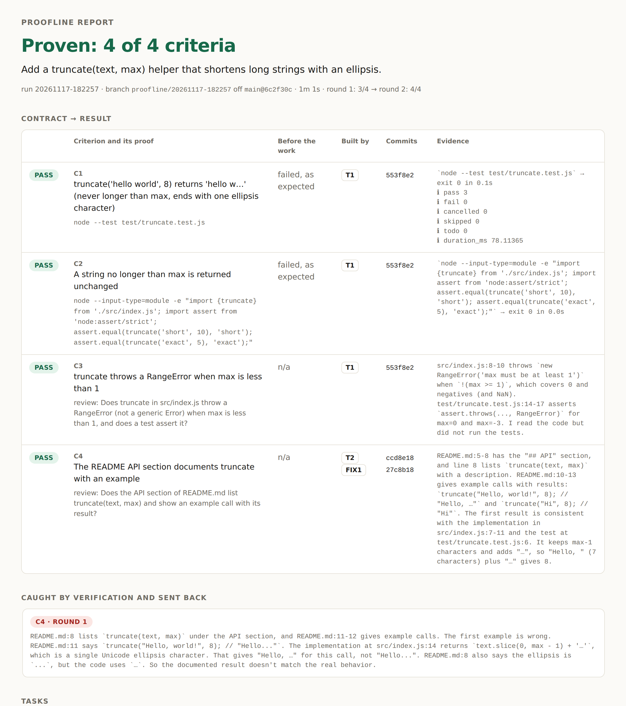
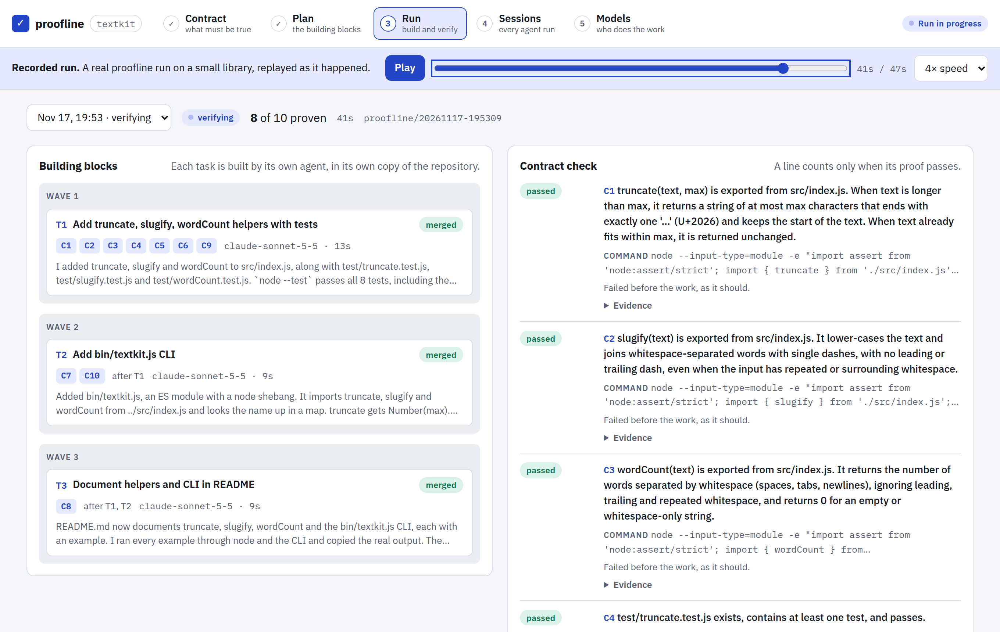
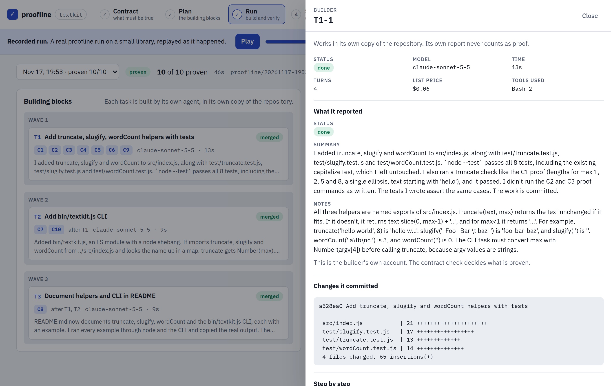
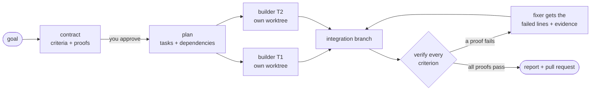
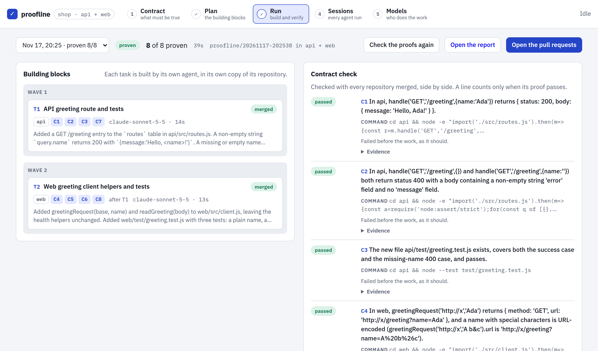

# proofline

**A contract-first orchestrator for coding agents. Every requirement gets a proof, and nothing is done until the proof passes.**

Coding agents are good at building and bad at knowing when they are finished. Ask one for a feature and it reports "done", with a confident summary, whether or not the feature works. The more work you hand over, the more of your day goes into checking that summary.

proofline turns the job around. Before anything is built you agree a short contract: numbered requirements, each with the proof that will show it holds. Agents then build in parallel, and a result counts only when its proof passes. The builder's own report is never used as evidence.

Here is a real run. Two agents worked in parallel: one wrote a `truncate` function, the other documented it. Both reported "done". The documentation described a result the code does not produce, and only the independent check noticed:

```
$ proofline run
18:22:57 run 20261117-182257 started on branch proofline/20261117-182257
18:22:57 baseline: 2 of 2 command proofs fail before the work, as they should
18:22:57 T1 building: truncate and its tests
18:22:57 T2 building: README entry
18:23:09 T1 built (1 commit)
18:23:12 T2 built (1 commit)
18:23:12 T1 merged
18:23:12 T2 merged
18:23:12 verifying 4 criteria at e7334d2 (round 1)
18:23:12 ✓ C1 (command)
18:23:12 ✓ C2 (command)
18:23:18 ✓ C3 (review)
18:23:26 ✗ C4 (review)
18:23:26 1 criterion not proven: sending C4 back (fix round 1)
18:23:26 FIX1 building: Fix C4
18:23:51 FIX1 merged
18:23:51 verifying 4 criteria at cbd8715 (round 2)
18:23:51 ✓ C1 (command)
18:23:51 ✓ C2 (command)
18:23:57 ✓ C3 (review)
18:23:58 ✓ C4 (review)

Proven: 4 of 4 criteria
Report:  .proofline/runs/20261117-182257/report.html
Next:    proofline ship
```

The verifier's reason for failing C4, from the report:

> README.md:11 says `truncate("Hello, world!", 8); // "Hello..."`. The implementation at src/index.js:14 returns `text.slice(0, max - 1) + '…'` [...] That gives "Hello, …" for this call, not "Hello...". So the documented result doesn't match the real behavior.

One minute, start to finish. The contract, plan and full report of this run are in [examples/textkit-truncate](examples/textkit-truncate).



## The control room

```sh
proofline ui
```

opens a local page for the repository you are in. Everything the command line does is there, plus what a terminal cannot show: agents working at the same moment.



| Screen | What you see and control |
|---|---|
| **Contract** | Type a goal and let the planner draft the contract, or write it yourself. Edit any requirement or proof, then approve. An edit after approval visibly voids it. |
| **Plan** | The building blocks: tasks grouped into waves that run in parallel, a coverage strip that turns red for a requirement nobody is responsible for, and a model picker on every task. |
| **Run** | Start, stop and resume. Each task shows its status and the step its agent is on right now; each requirement shows whether its proof failed before the work, its verdict per round, and the evidence. |
| **Sessions** | Every agent run, live and past. Open one for its report: the brief it was given, each step it took, what it answered, what it committed, its model, time and cost. |
| **Models** | Which model plans, builds and verifies; how many agents run at once; how often a failed line is sent back; and which accounts the run uses. |



A recorded real run can be replayed in the same interface without installing anything: open [`demo/index.html`](demo/index.html) from a checkout.

The page is served on `127.0.0.1` only. Because it can start agents that run shell commands, every request must carry a token that only the served page knows, and requests with an unknown `Host` are refused, so no other website open in your browser can drive it.

## How it works



1. **Contract.** A planner agent reads your repository and drafts 3 to 12 acceptance criteria. Each carries exactly one proof: a shell **command** that exits 0 only when the criterion holds, or, where no command can show it, a **review** question for an independent reader. You edit the file until it says what you mean and approve it. The approval is a hash of the contract; changing a single criterion afterwards voids it.
2. **Plan.** The planner splits the contract into tasks with dependencies. A validator, not the planner, decides whether the plan is acceptable: every criterion must have a task responsible for it, and every task must trace back to a criterion. Work nobody asked for does not get planned.
3. **Baseline.** Before any work, each command proof is run on the untouched code. A proof worth having fails here. One that already passes is labelled a guard in the report: fine for "the existing tests still pass", a warning sign for anything else.
4. **Build.** Tasks with no dependency between them are built at the same time, each by its own agent in its own git worktree, then merged one by one into an integration branch. Your checkout is never touched. If two tasks collide, the later one is rebuilt on top of the merged result instead of being hand-merged.
5. **Verify.** Command proofs are run by proofline itself: an exit code cannot be talked into passing. Review proofs go to a read-only agent that sees the criterion and the code, never the builder's reasoning, and must cite `file:line` evidence or fail the line.
6. **Send back.** Failed criteria return to a builder together with the verifier's evidence, and then *every* criterion is verified again, so a fix cannot quietly break a neighbour. After a set number of rounds the run stops and says plainly what is not proven.
7. **Report.** One page that links each requirement to the tasks that built it, the commits that changed it and the evidence that proves it. `proofline ship` pushes the branch and opens a pull request with that page as its description.

## Install

Requires Node 20+, git, and [Claude Code](https://claude.com/claude-code) signed in. The GitHub CLI (`gh`) is needed only for `ship`.

```sh
git clone https://github.com/nikitagudkovs/proofline && cd proofline
npm install && npm link
```

Then, in the repository you want to work on:

```sh
proofline ui        # the control room, in your browser
proofline doctor    # or, in the terminal: which accounts a run will use
```

```
✓ starts from     branch main: a run builds on it, and its pull request goes into it
✓ git author      commits are written as Ada Lovelace
✓ git remote      ship pushes to git@github.com:ada/engine.git
✓ GitHub account  pull requests are opened as ada
✓ Claude Code     agents run on your Claude subscription (max)
```

### It runs on your accounts, not on new ones

proofline holds no credentials and asks for none.

- **Claude:** every agent is a headless Claude Code process (`claude -p`), so it runs on the login Claude Code already has. With the default `auth: subscription`, `ANTHROPIC_API_KEY` and `ANTHROPIC_AUTH_TOKEN` are removed from each agent's environment, so a stray key in your shell cannot be billed. The report shows a list-price equivalent so you can see what a run would have cost per token; on a subscription it is not a charge.
- **GitHub:** pushes use your git remote and credentials; pull requests are opened by the account `gh` is signed in to. `proofline doctor` shows both before anything is pushed.

## Use

Everything below also works from the control room (`proofline ui`). From a terminal, step by step, with a human gate after each stage:

```sh
proofline contract "Let users export their invoices as CSV from the billing page"
$EDITOR .proofline/contract.yaml     # make it say what you mean
proofline approve
proofline plan
$EDITOR .proofline/plan.yaml         # optional
proofline run
proofline ship
```

Or in one go, stopping once for your approval of the contract:

```sh
proofline go "Let users export their invoices as CSV from the billing page"
```

| Command | What it does |
|---|---|
| `ui` | Opens the control room in your browser |
| `doctor` | Shows which GitHub account and Claude login a run will use, and the branch it starts from |
| `init --repos a,b` | Makes this folder a workspace of several repositories |
| `contract "<goal>"` | Drafts `.proofline/contract.yaml` |
| `approve` | Locks the contract as it stands |
| `plan` | Drafts `.proofline/plan.yaml` and validates it against the contract |
| `run` | Builds, verifies, sends failures back; `--resume` continues an interrupted run |
| `verify` | Runs the proofs again on an existing run |
| `status` | Lists runs, tasks and the last verdict per criterion |
| `ship` | Pushes the branch and opens a pull request; `--draft` allows an unproven run |
| `clean` | Removes a run's worktrees; the branch and the records stay |

`run` exits 0 when the contract is proven and 2 when it is not, so it can gate a pipeline.

### A frontend and a backend in one delivery

Most real features cross a seam: an endpoint in one repository, the screen that calls it in another. Run proofline in the folder that holds both and tell it once which repositories belong together:

```sh
cd ~/work/shop                      # holds api/ and web/, each its own git repository
proofline init --repos api,web
proofline ui
```

From then on that folder is a workspace, and a run is one delivery across it:

- **One contract, one plan.** Each task names the repository it changes. A task that depends on the other side (`needs`) starts after that side is merged and can read it, so a screen is built against the endpoint that exists, not the one the builder imagines.
- **Verified together.** Proofs run only after every side is delivered, in a copy where the repositories sit side by side, each with all of its work merged. Commands start by entering a repository (`cd api && npm test -- greeting`). A review proof can ask about the seam itself: does the request the frontend sends match what the backend accepts, field by field?
- **Fixed across the seam.** When a line fails, the fixer gets every repository and is told to correct the side that is wrong, not to patch one to fit a mistake in the other.
- **A pull request per repository**, each into the branch that repository was on when the run started, each pointing at the other.

A builder never writes into another repository: what it reads there is a separate copy, wiped before the next task uses it. Your own checkouts are not touched, as in a single repository.



### The contract

```yaml
goal: Let users export their invoices as CSV from the billing page.
out_of_scope:
  - PDF export
  - Changing how invoices are stored
criteria:
  - id: C1
    text: GET /invoices.csv returns one row per invoice of the signed-in user
    proof: { command: "npx vitest run test/invoices-csv.test.ts" }
  - id: C2
    text: Amounts are written with two decimals and no currency symbol
    proof: { command: "npx vitest run test/invoices-csv-format.test.ts" }
  - id: C3
    text: The billing page has an "Export CSV" button that links to the endpoint
    proof: { review: "Does the billing page render a control labelled Export CSV that points at /invoices.csv?" }
```

The contract is plain YAML in your repository. Write it by hand, let the planner draft it, or both. `approve` warns about proofs worth a second look: several criteria sharing one command, words no proof can check ("properly", "robust"), and contracts that lean mostly on review.

### Settings

`.proofline/config.yaml`, all optional:

```yaml
concurrency: 3        # builders at the same time
maxFixRounds: 2       # times failed criteria go back to a builder
setup: "npm ci"       # prepares every copy of the repository: each task's, and the one the proofs run in
auth: subscription    # or "inherit" to pass API keys through
models:               # alias or id per role; empty = your Claude Code default
  planner: opus
  builder: sonnet
  verifier: sonnet
claudeArgs: []        # extra arguments for every agent, e.g. ["--setting-sources", "project"]
```

`setup` runs with `PROOFLINE_SOURCE` set to your own checkout, for what git does not track: `ln -sfn "$PROOFLINE_SOURCE/node_modules" node_modules` is faster than a fresh install, and whatever the command leaves behind is kept out of the commits. In a workspace each repository has its own:

```yaml
repos:
  - path: api
    setup: cp "$PROOFLINE_SOURCE/config/master.key" config/
  - path: web
    setup: ln -sfn "$PROOFLINE_SOURCE/node_modules" node_modules
```

A single task can use a different model from the other builders: set `model:` on it in `.proofline/plan.yaml`, or pick it on the Plan screen.

## Design decisions

**The proof is chosen before the work, by someone other than the builder.** An agent asked to build and then to confirm its own work has every reason to find that it succeeded. Here the proof exists first, a person signs it off, and the builder is told it will be checked with it.

**Exit codes over opinions.** Wherever a command can prove a criterion, a command is used, and the harness runs it. Agent judgement is the fallback, and it is fenced: read-only tools, no view of the builder's output, evidence required, "unsure" counts as fail.

**A proof has to be able to fail.** Each command proof is run before the work as well as after. Red before and green after is evidence; green both times is only a guard, and the report says which is which.

**Agents cannot renegotiate the contract.** A builder that finds a proof which could never pass is told not to bend the product around it. It raises a concern, the report shows it, and the person who owns the contract decides.

**The plan is validated, not trusted.** Coverage in both directions (no criterion without a task, no task without a criterion), no dependency cycles, and a plan is bound to the hash of the contract it was made for.

**State on disk, not in a conversation.** Every transition is written to `.proofline/runs/<id>/state.json`. Kill a run, hit a usage limit, close the laptop: `proofline run --resume` picks up with the merged work intact and rebuilds only what was unfinished.

**Small surface.** The orchestrator and its server are about 3,400 lines of TypeScript with one runtime dependency (a YAML parser); the control room is about 1,900 lines of React, built ahead of time. The agent runtime sits behind a single-method interface, [`Engine`](src/engine.ts), which is also how the test suite runs whole orchestrations, and the server's API, with scripted agents and real git, in a few seconds and without spending a token.

More in [docs/design.md](docs/design.md).

## Limits, stated plainly

- **A weak proof proves little.** If the contract says `npm test` and the builder writes a test that asserts nothing, the line passes. The defence is the human approval of the contract and the lint; it is not automatic.
- **Builders run shell commands** in their worktree with your user's permissions. Point proofline at repositories and goals you would hand to Claude Code directly, or run it in a container.
- **Review proofs are judgement.** They are independent and must cite evidence, but they are still a model reading code. Prefer commands.
- **A workspace is not a transaction.** Its pull requests are opened together and point at each other, but nothing stops one being merged without the other.
- **Claude Code is the only engine today.** Others fit behind the same interface.

## Development

```sh
npm install
npm test
```

The tests in [`test/run.test.ts`](test/run.test.ts) are the best tour of the behaviour: a builder that falsely reports "done" and is caught by its proof, two tasks that collide, a run that is stopped or interrupted and resumed, and a contract edited mid-run. [`test/workspace.test.ts`](test/workspace.test.ts) does the same for a delivery across two repositories. [`test/server.test.ts`](test/server.test.ts) drives the control room's API the same way.

To rebuild the recorded demo from a run of your own: finish a run with `proofline ui` open, then `node scripts/export-demo.mjs` and `node scripts/build-demo.mjs`.

## License

MIT
